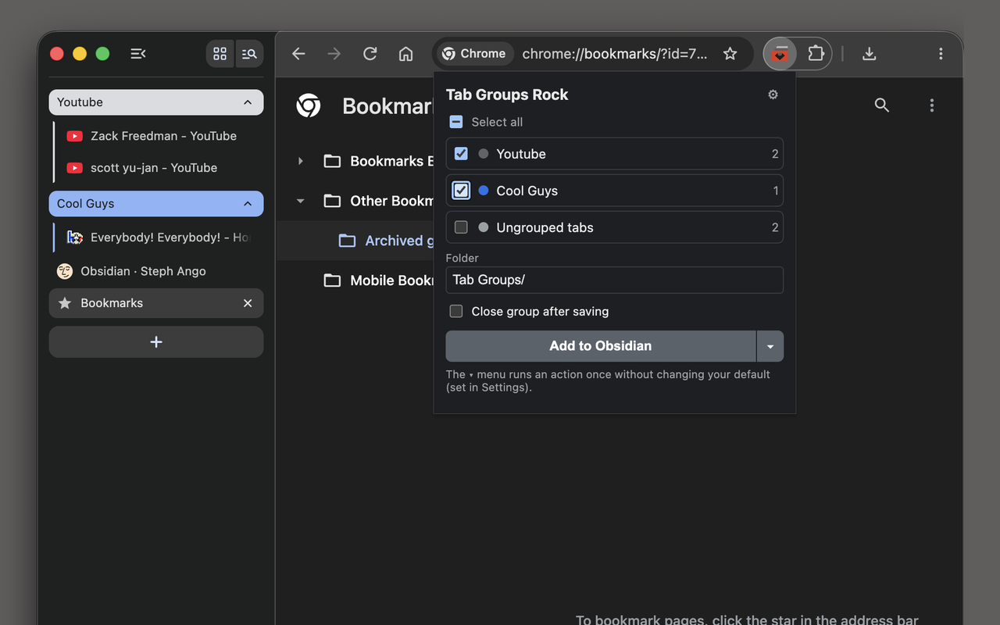
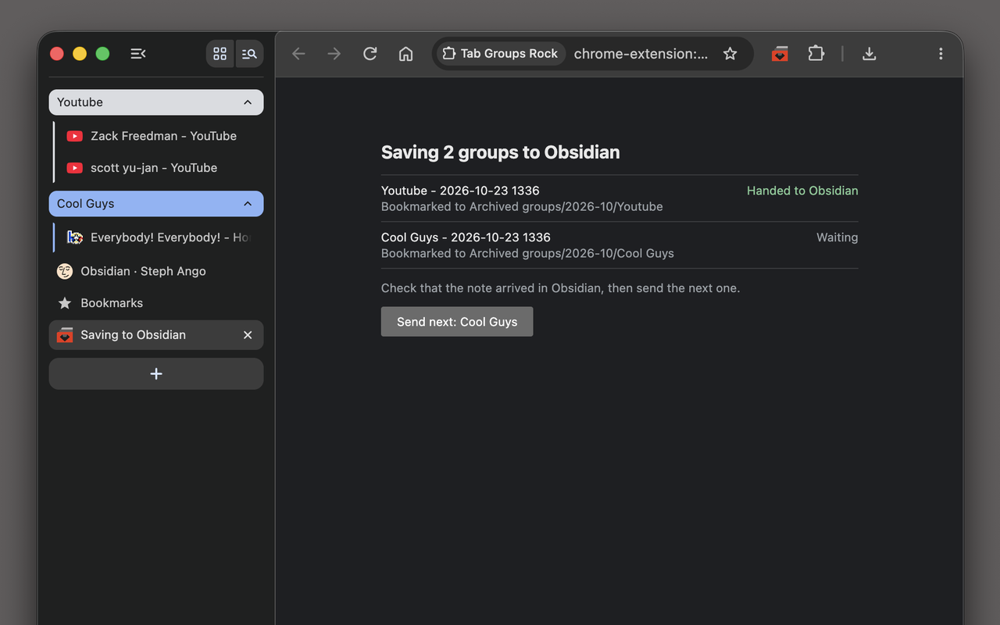
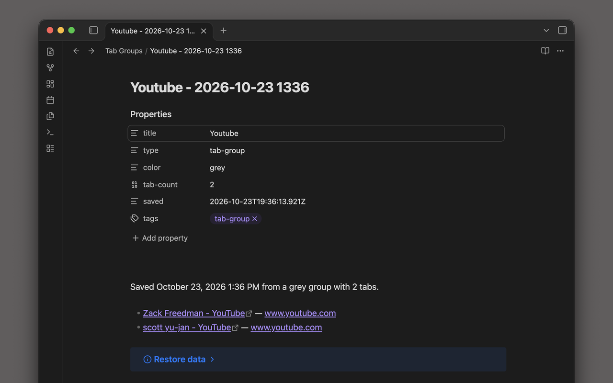
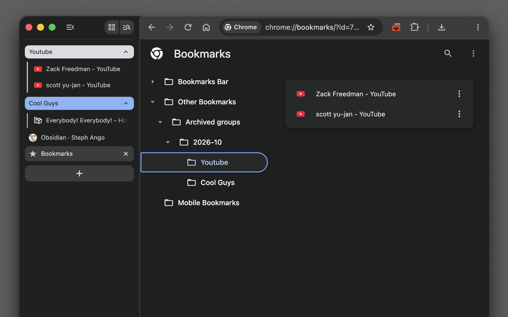

# Tab Groups Rock

Archive Chrome tab groups as Markdown notes in Obsidian, with a link to every tab, then close them and clear the clutter.

Free and open source.

## Overview

Tab groups are a good way to park a project, but they pile up, and Chrome has no way to archive one. Tab Groups Rock turns each group you pick into a note in your Obsidian vault: the group's name and color in the note's properties, and a link to every tab. Then it offers to close the tabs.

- **Archive several groups at once.** Tick the groups in the popup, or right-click any page and choose "Save this tab's group to Obsidian". Cmd+Shift+G (Ctrl+Shift+G on Windows and Linux) opens the popup.
- **Close the tabs when you're done.** Tick "Close group after saving". You're always asked before any tab is closed.
- **Get a bookmark folder too.** Each group is also saved under Other bookmarks › Archived groups, sorted by month. Right-click a folder and choose "Open all in new tab group" to bring the group back.
- **No Obsidian? No problem.** Download each group as a Markdown file or copy it to the clipboard instead.

Notes reach Obsidian the same way the official Obsidian Web Clipper sends them, so there's no plugin to install and nothing to configure in Obsidian. You need the Obsidian desktop app, version 1.7.2 or later.

## Screenshots

**Pick the groups to archive.**

**Each group is handed to Obsidian and bookmarked.**

**The note in your vault.**

**The bookmark folder, ready to reopen as a group.**

## Privacy

Tab Groups Rock collects nothing and sends nothing anywhere. It reads only the titles and addresses of the tabs in the groups you choose, never page content. See the [privacy policy](privacy).

## Links

- [Chrome Web Store](https://chromewebstore.google.com/detail/tab-groups-rock/geblmpmngeddhbpiicggajafocffkdch)
- [Source code and documentation](https://github.com/jsmusgrave/tab-groups-rock)
- [Report a problem or suggest an idea](https://github.com/jsmusgrave/tab-groups-rock/issues)

If it saves you some clutter, you can buy me a coffee.

<small>Obsidian is a trademark of Dynalist Inc. Tab Groups Rock is not affiliated with or endorsed by Obsidian.</small>
